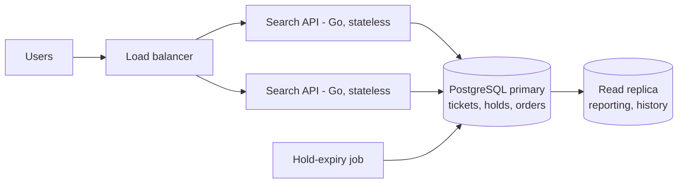
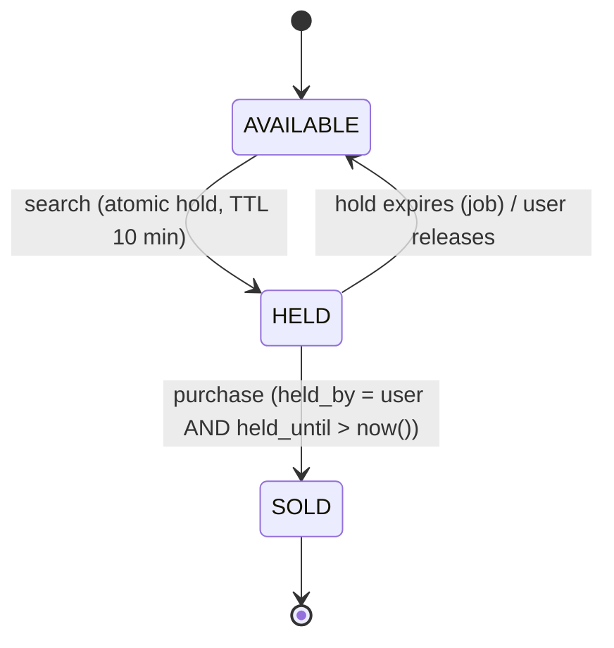

# Lottery Search System — Design Proposal

## 1. Problem Summary

- **10 million** lottery tickets, each with a **6-digit number** (`000000`–`999999`).
- Users search with a 6-character pattern of digits and `*` wildcards (`****23`, `1****5`, `123***`).
- **Distribution constraint:** when several users search the same pattern at the same time, no ticket
  may be returned to more than one of them.
- The search must stay fast at 10M+ records.

### Key observation

There are only **1,000,000 distinct numbers**, but **10,000,000 tickets**, so each number exists on about
**10 physical tickets** (different sets/series). This drives two design choices:

1. Search operates on a small, fixed domain (1M numbers). The number of numbers that match a pattern is
   exactly `10^w`, where `w` is the number of wildcards.
2. Allocation must work on **ticket IDs**, not numbers. Two users can both receive `123456`, as long as they
   receive *different physical tickets*.

### Assumptions

- "Return a ticket to a user" means the ticket is **held (reserved)** for that user for a short time
  (for example, 10 minutes) until they buy it or the hold expires. Showing a ticket without holding it
  cannot satisfy the constraint, because two users could see and buy the same ticket.
- A search returns at most `N` tickets per request (for example, `N = 20`), not every match. A pattern
  such as `******` matches all 10M tickets; returning all of them is neither useful nor feasible.
- Tickets belong to a draw. Only the current draw is searchable.

## 2. Proposed Architecture



| Component | Responsibility |
| --- | --- |
| **Search API** (stateless, horizontally scalable) | Validates the pattern, builds the query, runs the atomic search-and-hold statement, returns held tickets. |
| **PostgreSQL primary** | Single source of truth for ticket state. Performs search and allocation in **one atomic statement**. |
| **Hold-expiry job** | Every few seconds, returns expired holds to `AVAILABLE`. |
| **Read replica** | Non-allocating reads (history, admin, analytics). Allocation always goes to the primary. |

## 3. Recommended Storage: PostgreSQL

**Why PostgreSQL:**

| Criterion | Reasoning |
| --- | --- |
| **Concurrency correctness** | `SELECT … FOR UPDATE SKIP LOCKED` lets many transactions pick *disjoint* rows from the same candidate set without blocking each other. This is the exact semantics of the distribution constraint, provided by the database itself. |
| **Query performance** | 10M narrow rows (about 2 GB with indexes) fit in memory on an 8 GB instance. B-tree and partial indexes give millisecond lookups (section 5). |
| **Durability** | Holds and sales are ACID. No dual-write between a cache and a database, so no reconciliation is needed after a crash. |
| **Operational simplicity** | One mature system that is well understood by most teams, with managed offerings (RDS, Cloud SQL), backups, PITR and monitoring. |

**Alternatives considered:**

| Option | Verdict |
| --- | --- |
| Redis (sets + Lua) | Very high throughput and atomic `SPOP` per number. However, it needs Postgres anyway for durable sales, which creates a dual-write consistency problem. Kept as the scale-out option (section 8). |
| Elasticsearch | Good wildcard search, but has no atomic "claim these rows" operation and is eventually consistent. Cannot enforce the constraint alone. |
| MongoDB | `findOneAndUpdate` is atomic but claims **one document per round trip**; claiming `N` tickets takes `N` operations or a transaction. Workable, but less natural than `SKIP LOCKED`. |

## 4. Data Model

```sql
CREATE TYPE ticket_status AS ENUM ('AVAILABLE', 'HELD', 'SOLD');

CREATE TABLE tickets (
    id           BIGINT GENERATED ALWAYS AS IDENTITY PRIMARY KEY,
    draw_id      INT          NOT NULL,
    number       CHAR(6)      NOT NULL CHECK (number ~ '^[0-9]{6}$'),
    set_no       SMALLINT     NOT NULL,              -- which physical set/series
    status       ticket_status NOT NULL DEFAULT 'AVAILABLE',
    held_by      BIGINT,                             -- user id
    held_until   TIMESTAMPTZ,
    sold_to      BIGINT,
    rand_key     INT          NOT NULL DEFAULT (random() * 2147483647)::int,

    -- one column per digit position, derived from number
    d1 SMALLINT GENERATED ALWAYS AS (substr(number,1,1)::smallint) STORED,
    d2 SMALLINT GENERATED ALWAYS AS (substr(number,2,1)::smallint) STORED,
    d3 SMALLINT GENERATED ALWAYS AS (substr(number,3,1)::smallint) STORED,
    d4 SMALLINT GENERATED ALWAYS AS (substr(number,4,1)::smallint) STORED,
    d5 SMALLINT GENERATED ALWAYS AS (substr(number,5,1)::smallint) STORED,
    d6 SMALLINT GENERATED ALWAYS AS (substr(number,6,1)::smallint) STORED,

    UNIQUE (draw_id, number, set_no)
);
```

**Why `rand_key`?** Without it, every user searching `****23` would compete for the same "first" rows
in index order. Starting each search at a random `rand_key` spreads concurrent users across the candidate
set, which reduces lock collisions and makes results fair (not always the lowest set numbers first).

## 5. Search Algorithm and Indexing

### 5.1 Pattern compilation

The API validates the pattern (`^[0-9*]{6}$`) and compiles it based on `w`, the number of wildcards:

| Fixed digits `k = 6 − w` | Matching numbers `10^w` | Matching tickets (about 10 each) | Strategy |
| --- | --- | --- | --- |
| 6 | 1 | ~10 | **Enumerate**: `number = '123456'` |
| 5 | 10 | ~100 | **Enumerate**: `number = ANY(10 values)` |
| 4 | 100 | ~1,000 | **Enumerate**: `number = ANY(100 values)` |
| 3 | 1,000 | ~10,000 | **Enumerate**: `number = ANY(1,000 values)` |
| 2 | 10,000 | ~100,000 (1%) | **Digit predicates**: `d5 = 2 AND d6 = 3` |
| 1 | 100,000 | ~1,000,000 (10%) | **Digit predicates** |
| 0 | 1,000,000 | all | No predicate |

This is a **selectivity-adaptive** strategy:

- **Selective patterns (`k ≥ 3`):** the candidate numbers are generated in the application (at most 1,000
  strings, built with a simple odometer over the wildcard positions) and looked up with an index probe per
  number. Because results are ordered by `rand_key`, the database reads every *available* matching ticket
  (at most ~10,000 index entries) and keeps the top N. The cost is bounded by the size of the match set,
  not the table size.
- **Broad patterns (`k ≤ 2`):** about 1% or more of tickets match. With `LIMIT N`, a random-order scan
  reads about `N / selectivity` rows, around `20 / 0.01 = 2,000` index entries, before it has enough hits.
  Enumerating 10,000 or more numbers would be slower than this *in the common case*.

The planner does not need to "understand" wildcards. Every pattern becomes plain equality predicates.

### 5.1.1 Sparse fallback (sold-out popular numbers)

The broad-pattern estimate assumes matching tickets are still spread through the available set. That is
not true for **popular endings that sell out** (very common in practice, e.g. `****23` on a lucky number).
If every ticket ending in `23` is sold, a scan with `d5 = 2 AND d6 = 3` would read the *whole* available
index (~10M entries) and find nothing, taking seconds.

Guard against it by bounding the broad scan and falling back to enumeration:

1. Run the broad scan in a bounded `rand_key` window (for example, `rand_key BETWEEN $start AND $start + W`,
   sized so that roughly 20,000 index entries are read). This caps the work per attempt.
2. If the window does not yield N tickets, switch to the **enumeration path**: probe the 10^w matching
   numbers through `idx_avail_number` in a random order and stop once N tickets are collected. A sold-out
   number costs one empty index lookup (microseconds), so `k = 2` costs at most 10,000 probes (~10–20 ms)
   and correctly returns "no tickets" when the pattern is sold out.
3. For `k ≤ 1` to be sparse, at least 10% of the draw must have sold on those numbers alone. This is rare,
   and the enumeration path still finishes in ~100 ms at worst.

A cheaper option for very hot draws is a small `number_stock(draw_id, number, available)` table (1M rows)
updated in the same transaction as a hold or sale. Searches can then skip numbers with `available = 0`
before touching `tickets`.

### 5.2 Indexes

All search indexes are **partial** on `status = 'AVAILABLE'`. Sold and held tickets drop out of the index
automatically, so searches never skip over unavailable rows, and the index shrinks as the draw sells out.

```sql
-- Enumerated lookups (k >= 3): exact number, then random order inside the number
CREATE INDEX idx_avail_number ON tickets (draw_id, number, rand_key)
    WHERE status = 'AVAILABLE';

-- Broad patterns (k <= 2): random-order scan, digit predicates filtered on the fly
CREATE INDEX idx_avail_rand ON tickets (draw_id, rand_key)
    WHERE status = 'AVAILABLE';

-- Hold expiry job
CREATE INDEX idx_held_until ON tickets (held_until)
    WHERE status = 'HELD';
```

Per-digit indexes (`d1`…`d6`) are not needed. For `k ≤ 2`, a filtered scan on `idx_avail_rand` is cheaper
than combining several low-selectivity bitmaps. The digit columns are used only as cheap filters.

## 6. Distribution: Atomic Search-and-Hold

Search and allocation are **one SQL statement**, so there is no window between "find" and "claim":

```sql
-- $1 draw, $2 user, $3 N, $4 random start, pattern predicate injected as parameters
WITH picked AS (
    SELECT id
    FROM tickets
    WHERE draw_id = $1
      AND status = 'AVAILABLE'
      AND number = ANY($5)          -- or: d5 = 2 AND d6 = 3   (broad patterns)
      AND rand_key >= $4            -- random start for fairness
    ORDER BY rand_key
    LIMIT $3
    FOR UPDATE SKIP LOCKED
)
UPDATE tickets t
SET status = 'HELD', held_by = $2, held_until = now() + interval '10 minutes'
FROM picked
WHERE t.id = picked.id
RETURNING t.id, t.number, t.set_no;
```

If fewer than `N` rows come back (the random start was near the end), the API runs the same statement
again with `rand_key < $4` to wrap around.

**Why this prevents duplicates:**

1. `FOR UPDATE` row-locks every selected ticket inside the transaction.
2. `SKIP LOCKED` makes a concurrent transaction **skip** rows that another transaction has locked,
   instead of waiting for them or reading them.
3. After commit, the rows are `HELD`, so they no longer match `status = 'AVAILABLE'` and are no longer in
   the partial index.

As a result, two concurrent searches for the same pattern always receive **disjoint** sets of tickets,
and neither blocks the other. This is the same pattern used by production job queues.

### Hold lifecycle



- **Purchase** is a conditional update, so an expired hold cannot be bought:
  `UPDATE tickets SET status='SOLD', sold_to=$u WHERE id=ANY($ids) AND status='HELD' AND held_by=$u AND held_until > now()`.
- **Expiry job** (every 5 s, batched):
  `UPDATE tickets SET status='AVAILABLE', held_by=NULL, held_until=NULL WHERE id IN (SELECT id FROM tickets WHERE status='HELD' AND held_until < now() LIMIT 5000 FOR UPDATE SKIP LOCKED)`.
- **Abuse control:** limit active holds per user (for example, 20) and rate-limit searches, so one client
  cannot lock up a whole pattern.

## 7. Performance Analysis

| Operation | Cost | Expected latency* |
| --- | --- | --- |
| Pattern compile (`k ≥ 3`) | O(10^w) ≤ 1,000 strings in memory | < 0.1 ms |
| Search-and-hold, `k ≥ 3` | ≤ 1,000 index probes, ≤ ~10,000 entries read, top-N sort | 2–5 ms |
| Search-and-hold, `k ≤ 2` (common case) | ≈ N / selectivity rows scanned (~2,000) | 1–5 ms |
| Search-and-hold, `k = 2`, pattern sold out | Bounded window + ≤ 10,000 empty probes (section 5.1.1) | 10–20 ms |
| Search-and-hold, `******` | N rows | < 1 ms |
| Purchase | N primary-key updates | < 2 ms |

\*Single primary, data in memory.

**Memory/storage:** a row is about 120 bytes on disk once the Postgres tuple header (~24 bytes) and
alignment are included, so the table is about 1.2 GB. The three partial B-tree indexes add roughly
0.6–0.9 GB while most tickets are available, for a total of about **2 GB**. This fits in the buffer cache
of an 8 GB instance.

**Throughput:** each search is one short transaction that touches about N rows. A single primary handles
several thousand search-and-hold operations per second. `SKIP LOCKED` keeps lock waits near zero, even for
hot patterns.

**Tradeoffs:**

| Decision | Benefit | Cost |
| --- | --- | --- |
| Hold-on-search | Hard guarantee of no duplicate results | Inventory is temporarily locked by browsers; mitigated by short TTL and per-user hold caps |
| Single primary for allocation | Simple, strongly consistent | Write throughput is bounded by one node; see section 8 |
| Partial indexes | Indexes shrink as tickets sell; no wasted scans | Index maintenance on every status change (cheap: small B-tree update) |
| Random order | Fair results, fewer lock collisions | Results are not sorted by number (can be sorted after retrieval) |
| Enumeration threshold at k = 3 | Bounded work for every pattern | Arrays of up to 1,000 parameters; fine for Postgres |
| Bounded broad scan + fallback | No multi-second worst case when popular numbers sell out | Two query paths to maintain and test |

## 8. Scaling Beyond a Single Node

If traffic exceeds what one primary can handle (for example, draw-day spikes):

1. **Partition by `draw_id`** (and archive old draws), so the hot table only contains the current draw.
2. **Shard by the last digit of `number`** across 10 primaries. A pattern with a fixed last digit routes to
   one shard. A pattern with `*` in the last position fans out, takes `N/10` from each shard, and merges.
   If a shard returns fewer than its share, the API tops up from the other shards. Allocation is still
   atomic inside each shard, and shards hold disjoint tickets, so the constraint still holds.
3. **Redis front tier for extreme read/hold rates:** keep one Redis SET of available ticket IDs per number
   (`avail:{draw}:{number}`) and run a Lua script that enumerates matching numbers and `SPOP`s up to N IDs
   atomically. A Lua script runs atomically in Redis, which gives the same no-duplicate guarantee.
   Postgres stays the system of record: holds are written asynchronously, and purchase confirmation still
   uses the conditional `UPDATE` from section 6, so a Redis failure can never cause a double sale.
   This adds a reconciliation job to the system and is only worth it at very high scale.

## 9. Summary

- **Storage:** PostgreSQL, one table, with digit positions as generated columns and partial indexes on available tickets.
- **Search:** pattern compiled by selectivity. Narrow patterns enumerate at most 1,000 candidate numbers for index
  probes. Broad patterns use a bounded random-order index scan with digit filters, falling back to enumeration when
  popular numbers sell out. All patterns run in milliseconds at 10M rows, including the sold-out worst case.
- **Distribution:** one atomic `UPDATE … FROM (SELECT … FOR UPDATE SKIP LOCKED)` statement holds tickets for the user.
  Concurrent searches for the same pattern get disjoint tickets without blocking, and holds expire automatically.
- **Production path:** works on a single managed Postgres instance, with a clear path to partitioning, sharding or a
  Redis tier if load requires it.
